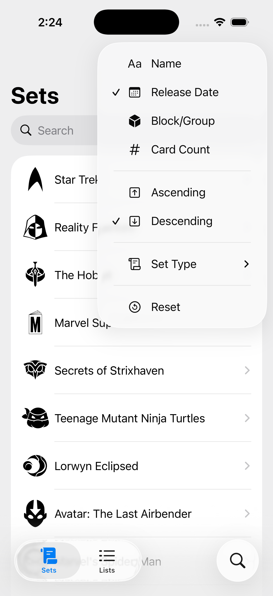
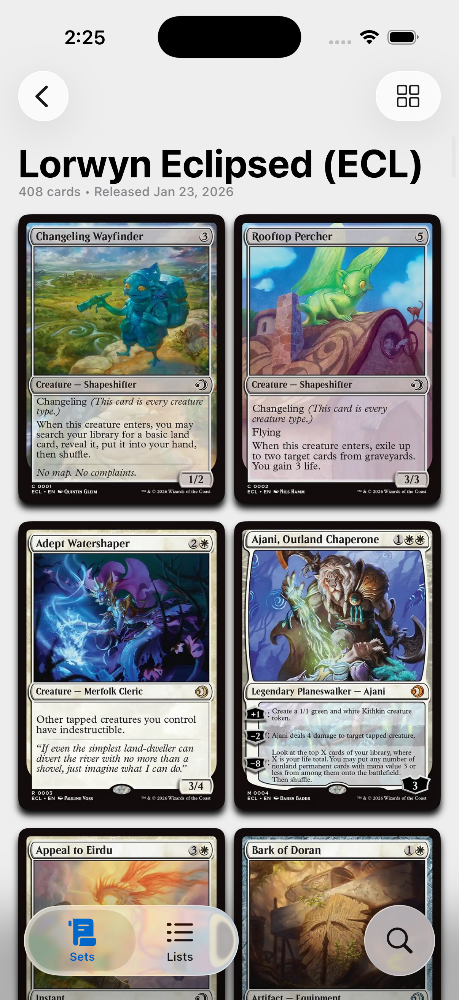
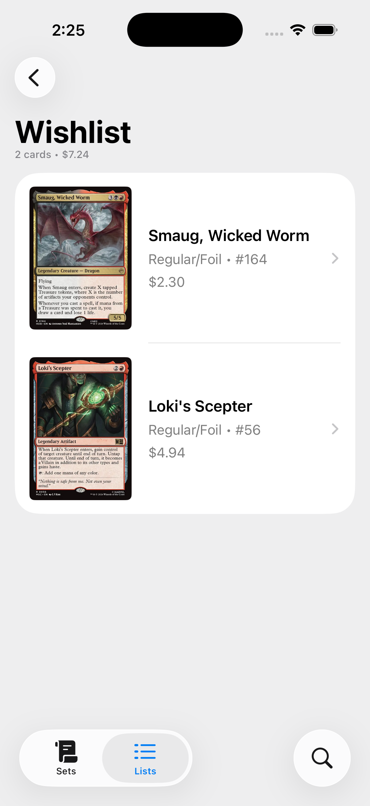
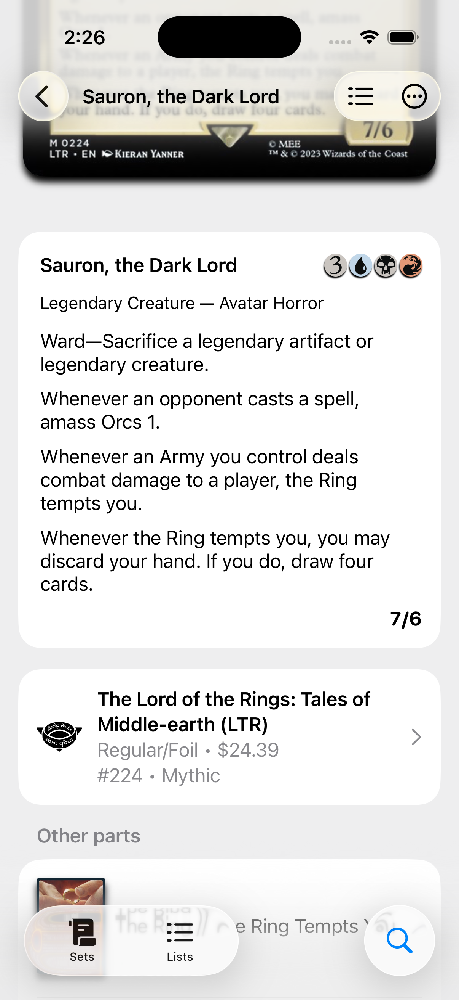
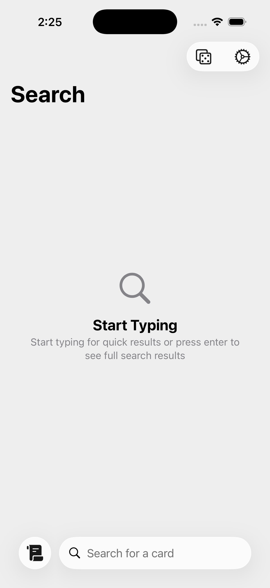
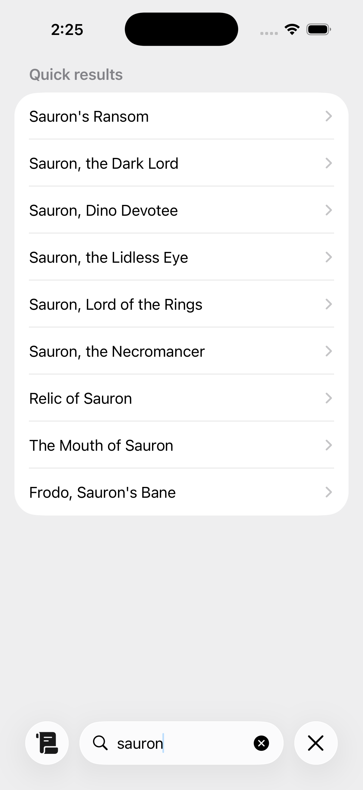

#  Stack

## What is Stack?
Stack is a MTG lookup and card list management app

## Features
- Modern, platform aligned design
- Full implementation of the Scryfall API
- Random card button
- Oracle tag support
- Save lists of cards
- Link to various purchase sites

## What technology does Stack showcase?
- Approachable concurrency w/default @MainActor isolation
- Modern async/await
- SwiftData to persist lists of cards
- Router based navigation
- Task groups for loading extra card details

## Screenshots
     
     
     
